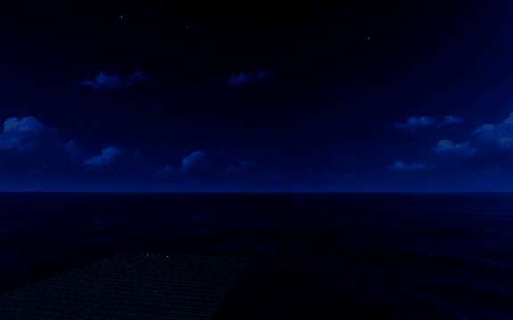
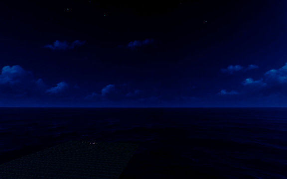
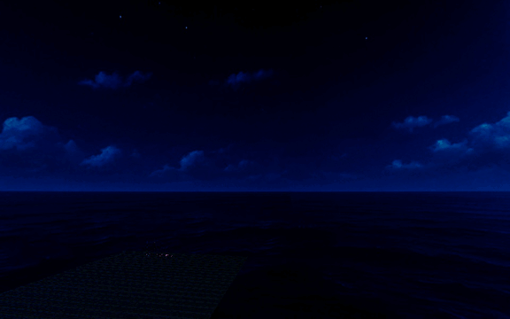

# 🎆 VR 폭죽 발사 프로젝트

Unity 맵 제작자가 자신의 씬에 배치하고 커스터마이즈할 수 있는 VR 폭죽 제작 도구를 개발하는 프로젝트입니다.
최종 목표는 참고 이미지의 선을 따라 터지는 폭죽을 제작하고, 맵 제작자가 자기 프로젝트에 가져다 쓸 수 있도록 `.unitypackage` 형태로 배포하는 것입니다.

## 📌 프로젝트 소개

컨트롤러의 트리거를 당겨 폭죽을 발사하고, 폭발 형태와 크랙클 효과의 차이를 경험할 수 있도록 제작하고 있습니다.

XR 시뮬레이터에서 폭죽을 발사할 수 있으며, 별·하트·꽃 등 다양한 패턴이 입체적으로 펼쳐집니다. 빛이 번지는 Bloom과 별빛 입자, 교차하는 링, 색이 변하는 잔광으로 연출을 구성했습니다.

**현재 단계는 장기 프로젝트의 1차 구현입니다.** 기말 제출 시점에는 VR 폭죽의 발사와 시각 효과를 구현했습니다. 핵심 아이디어인 이미지 기반 폭죽 제작과 패키지 배포는 이후 단계에서 진행할 예정입니다.

## 👤 기말 제출 시점까지의 기여 내역

### 본인 작업

- VR 컨트롤러로 폭죽을 발사하고 감상하는 프로젝트를 기획하고, XR 시뮬레이터에서 컨트롤러 트리거로 폭죽이 발사되도록 기본 동작을 구현했습니다.
- 발사 방향을 보정하고, 폭발만 표시되는 폭죽, 크랙클만 표시되는 폭죽, 두 효과가 이어지는 폭죽의 기본 틀을 만들었습니다.
- 직접 실행하면서 폭죽이 평면처럼 보이는 점과 Bloom이 눈에 띄지 않는 점을 발견해 개선 방향을 제시했습니다. 이미지 형태의 폭죽과 저사양 PC용 후처리 전환 버튼을 후속 과제로 정했습니다.
- 맵 제작자가 이미지를 바꿔 원하는 폭죽 형태를 만들 수 있는 기능을 구상하고, Unity 맵 제작용 패키지로 배포하는 방향을 정했습니다.

### AI 지원 작업 (Codex · Unity MCP)

- Unity 씬과 기존 코드에서 시각 효과의 문제를 분석하고, 입자의 3D 배치, 별빛과 장식 링, 색상과 잔광을 개선하는 코드를 작성했습니다.
- 주 폭발의 불꽃 끝을 기준으로 Combined의 크랙클이 이어지도록 수정했습니다. 컨트롤러 입력과 발사 방향 보정은 기존 구현을 유지했습니다.
- 사용자와 정한 바다 연출 방향에 따라 폭발과 크랙클의 색을 수면에 반사광으로 표현했습니다.
- 사용자가 제안한 서브컬처풍의 곡선 잔상을 일반 폭발형과 복합형에 적용했습니다. 불꽃이 패턴을 그리며 퍼진 뒤 감속하고, 끝이 감기며 아래로 휘어집니다.
- URP의 HDR 및 후처리 리소스를 연결하고 Bloom을 조정했습니다. Unity Game 화면에서 Bloom 켜짐·꺼짐을 비교하고, 별 폭죽을 정면·사선·측면에서 확인했습니다.
- 스크립트별 변경 사항과 개발 중 발견한 원인을 README에 정리했습니다.

변경 범위는 [첫 프로젝트 업로드](https://github.com/back0607-wq/23101685/commit/69d3735)와 [AI 지원으로 적용한 시각 효과 개선](https://github.com/back0607-wq/23101685/commit/ccd91e9)에서 확인할 수 있습니다.

## 🛠️ 개발 환경

- Unity 6.3 LTS (`6000.3.26f1`)
- Universal Render Pipeline (URP), XR Interaction Toolkit, OpenXR
- XR 시뮬레이터로 컨트롤러 입력 확인
- MCP for Unity는 에디터에서 개발을 보조하는 패키지입니다.

Unity Hub에서 프로젝트를 열고 [메인 씬](Assets/VR_23101685%201/vr_23101685.unity)을 연 뒤 Play를 누릅니다. XR 시뮬레이터에서 폭죽을 잡고 컨트롤러 트리거를 당기면 발사됩니다.

## 🎬 복합형 폭죽 시연

Unity 재생 모드에서 촬영했습니다. 불꽃 색이 물결처럼 수면에 길게 번지고, 불줄기 끝에서 크랙클이 터질 때 물 위에서도 작게 반짝입니다.

| 꽃 모양 | 별 모양 | 하트 모양 |
| :---: | :---: | :---: |
|  |  |  |

## ✅ 현재 구현된 기능

### 컨트롤러 입력을 통한 폭죽 발사
- XR 시뮬레이터에서 컨트롤러의 트리거 입력으로 폭죽을 발사할 수 있습니다.

### 폭죽 효과 3종
| 종류 | 구현 내용 |
| --- | --- |
| 폭발 + 크랙클 | 폭죽이 터진 뒤 크랙클 효과가 남습니다. |
| 폭발 | 크랙클 없이 폭발 효과만 나타납니다. |
| 크랙클 | 폭발 효과 없이 크랙클 효과만 나타납니다. |

별도로 손에 들고 켤 수 있는 스파클러도 있습니다.

## 🔧 기존 스크립트에서 바뀐 부분

| 파일 | 변경 내용 |
| --- | --- |
| `VideoBurstController.cs` | 폭발 입자에 앞뒤 깊이를 주고, 별빛과 기울어진 장식 링을 더했습니다. 일반 폭발형과 복합형의 주 불꽃은 펼쳐진 뒤 감속하며 아래로 휘고, 복합형은 크랙클이 이어질 대표 불줄기를 별도로 선택합니다. |
| `CrackleOnlyLayout.cs` · `CrackleOnlyBurst.cs` | 패턴의 윤곽을 유지하면서 앞뒤로 불꽃을 분산합니다. 링은 두께가 있는 도넛 형태로 배치하고, 크랙클 입자의 크기와 지속 시간을 조절했습니다. |
| `FireworkBurstDispatcher.cs` · `AfterburstSequence.cs` | 폭발 패턴의 방향을 전달하고, 복합형의 후속 불꽃은 주 폭발과 같은 형태를 따릅니다. 복합형의 마지막 크랙클은 대표 불줄기가 희미해지는 순간의 위치를 읽어 끝점에서 한 번씩 발생합니다. |
| `FireworkProp.cs` · `VideoLookTypes.cs` | 무작위 발사에서 사용하는 색을 분홍·보라·하늘색·금색 계열로 정돈했습니다. 기존 컨트롤러 입력과 발사 방향 보정은 유지했습니다. |
| `FireworkWaterReflection.cs` · `FireworkWaterReflection.shader` | 폭발과 크랙클의 위치·색·타이밍을 받아, 바다 배경에 부드럽게 움직이는 반사광을 렌더링합니다. |
| `PrettyGlowURP.shader` · `CrackleOnlyGlow.shader` | 십자 모양의 별빛과 크랙클 반짝임을 보강했습니다. |

## 📝 개발 중 확인한 점

- **모양과 방향은 따로 다뤄야 합니다.** 기존 코드에서는 별의 안쪽과 바깥쪽 반경을 계산한 뒤 벡터를 정규화해 반경 차이가 사라졌습니다. 형태가 필요한 입자는 목표 위치의 반경을 유지하고, 앞뒤 깊이를 추가해 측면에서도 부피가 보이도록 했습니다.
- **Bloom은 카메라와 URP 설정을 함께 확인해야 합니다.** 씬에 Bloom 볼륨이 있어도 실제 렌더러의 후처리 데이터가 비어 있었고 HDR이 꺼져 있었습니다. 카메라 후처리, 렌더러 리소스, URP의 HDR을 연결한 뒤 Game 화면에서 같은 프레임의 Bloom 켜짐과 꺼짐을 비교했습니다.
- **색과 빛 번짐은 여러 설정이 함께 만듭니다.** 팔레트와 발광 셰이더가 불꽃의 기본 색을 만들고, 톤 매핑과 색 보정이 화면의 대비와 채도를 조절합니다. Bloom은 밝은 불꽃 주변에 빛 번짐을 더합니다.
- **후속 효과의 위치를 주 폭발과 연결해야 합니다.** 독립적으로 고른 후속 패턴은 처음 형태와 연결이 약했습니다. 주 불꽃의 끝을 기준으로 크랙클을 배치해 하나의 연출로 이어지도록 했습니다.
- **정면 화면만으로는 깊이를 판단하기 어렵습니다.** 동일한 별 폭죽을 정면·사선·측면에서 확인했고, 런타임에서 입자가 앞뒤로 분포하는 것을 확인했습니다. 실제 헤드셋의 시각 품질과 성능 검증은 남아 있습니다.

## 🌸 향후 개발 계획

### 1. 서브컬처 감성의 폭죽 비주얼 제작

별빛, 색상 팔레트, 입체 패턴과 Bloom을 적용했습니다. 실제 VR 기기에서 형태의 선명도와 밝기, 연속 발사 시 성능을 확인하고 다듬을 예정입니다.

- 폭죽 종류별 대표 색상과 패턴 조합 다듬기
- 공간에 빛이 퍼지는 느낌을 위한 볼륨메트릭 연출 실험
- 저사양 PC를 위한 **후처리 켜기·끄기 버튼** 추가. 설정 메뉴에서 Bloom, 톤 매핑, 색 보정 같은 카메라 후처리를 끌 수 있게 하고, 켜짐과 꺼짐 상태의 프레임 시간을 비교합니다.

### 2. 이미지의 선을 따라 펼쳐지는 폭죽 제작

맵 제작자가 Unity에서 PNG나 참고 이미지를 지정하면, 도구가 이미지의 외곽선과 주요 내부 선을 읽어 파티클 목표 위치로 변환하는 기능을 구상하고 있습니다. 폭죽을 발사하면 공중에서 불꽃이 그 선을 따라 펼쳐져 원본 이미지의 형태를 알아볼 수 있게 하는 것이 목표입니다. 지정한 이미지를 교체하면 같은 폭죽에 다른 형태를 적용할 수 있도록 합니다.

- 단순한 선화와 투명 배경 PNG로 선 추출 및 파티클 배치 실험
- 노드 기반 시각 효과 제작 방식 검토
- 심볼처럼 선이 뚜렷한 이미지부터 발사 후 형태가 잘 읽히는지 확인

### 3. 맵 제작용 Unity 패키지 배포

폭죽 프리팹, 이미지 설정 도구, 사용 예시를 `.unitypackage`로 묶을 예정입니다. 별도의 Unity 프로젝트에서 패키지를 가져온 뒤, 맵 제작자가 프리팹을 씬에 배치하고 자신의 이미지로 교체하는 흐름을 검증합니다.

## 🚧 현재 진행 상황

- [x] XR 시뮬레이터에서 트리거 입력 연결
- [x] 폭죽 발사 기능 구현
- [x] 기본 폭죽 효과 3종 구현
- [x] 별빛 입자, 잔광, 색상 팔레트와 Bloom 적용
- [x] Bloom의 확산 범위를 넓혀 불꽃 주변으로 부드럽게 번지도록 조정
- [x] 폭발과 크랙클에 맞춘 수면 반사광
- [x] 폭발 패턴과 크랙클의 입체 배치
- [x] 일반 폭발형과 복합형의 곡선 불줄기 및 복합형 크랙클 위치 연동
- [ ] 실제 VR 기기에서 시각 품질 및 성능 검증
- [ ] 저사양 PC용 후처리 전환 버튼 추가 및 성능 비교
- [ ] 노드 기반 시각 효과 제작 방식 학습
- [ ] PNG·참고 이미지의 선을 읽어 폭죽 형태로 변환
- [ ] 맵 제작 도구를 `.unitypackage`로 구성하고 다른 프로젝트에서 검증
---
## 피드백
### 11.25
- 플레이 영상 녹화 요청
